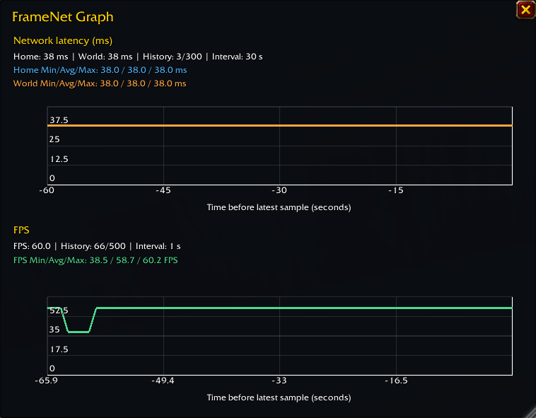
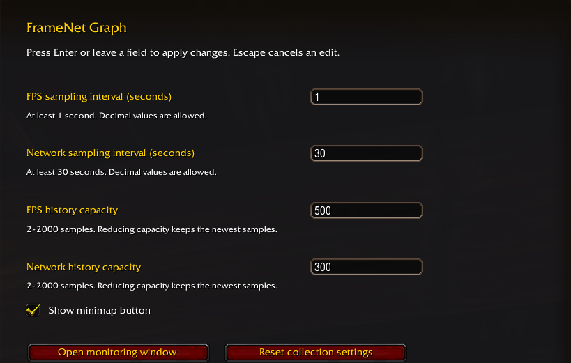

# FrameNet Graph

A lightweight World of Warcraft addon that shows FPS and Home/World network latency over time.

Watch for FPS drops and latency spikes using two graphs, current readings, and Min/Avg/Max
statistics. Measurements stay local and collection continues while the window is hidden.

By **uFARme**. Built for **WoW Retail** and **WoW Forever**.

## Features

- Separate FPS and network graphs with automatic Y-axis scaling.
- Blue Home and orange World latency lines on a shared scale in milliseconds.
- Current values and Min/Avg/Max for FPS, Home, and World.
- Independent sampling intervals and configurable history capacities.
- A movable, resizable window with saved size and position.
- Blizzard Settings integration and a draggable minimap button.
- In-memory history with fixed-capacity ring buffers; settings persist between sessions.
- Embedded libraries, with no separate addon dependencies to install.

## Screenshots

### Monitoring window



Home and World lines overlap when their values are equal.

### Settings



The screenshots show example settings; default history capacity is 200 samples per collector.

## Installation

When a packaged version is published, download its addon ZIP from
[GitHub Releases](https://github.com/FAR747/framenet-graph/releases) and extract the
`FrameNetGraph` folder into your client's `Interface/AddOns` directory. Use the
attached addon ZIP rather than GitHub's automatic **Source code** archives.

Until a packaged release is available, install from the repository source:

1. Download the repository using **Code > Download ZIP**, or use an existing checkout.
2. Create a `FrameNetGraph` folder in your client's `Interface/AddOns` directory:

   ```text
   World of Warcraft/_retail_/Interface/AddOns/FrameNetGraph/
   World of Warcraft/_forever_/Interface/AddOns/FrameNetGraph/
   ```

3. Copy `FrameNetGraph.toc`, `LICENSE`, and the complete `Core/`, `UI/`, `Libs/`, and `Media/`
   directories into that folder. `FrameNetGraph.toc` must be directly inside
   `Interface/AddOns/FrameNetGraph`, without an extra nested repository folder.
4. Restart the client if it was running, enable **FrameNet Graph** in the AddOns list,
   and enter the world.
5. Type `/fng` or left-click the minimap button to open the graphs.

Repeat the installation for each client you want to use. The network graph needs two
samples to draw a line, so allow at least 30 seconds at the default interval.

## Usage

| Command | Action |
|---|---|
| `/fng` | Open or hide the monitoring window |
| `/fng status` | Print collection state, history counts, latest values, and sample ages |
| `/fng settings` | Open Blizzard Settings > AddOns > FrameNet Graph |
| `/fng set <setting> <value>` | Change a collection setting immediately |

Drag the title bar to move the window and the bottom-right grip to resize it.
Close it with the close button, Escape, or `/fng`. Its size and position are saved;
it starts hidden after `/reload` or login. Saved geometry is kept within the current screen.

**Minimap button:** left-click toggles the window, right-click opens settings, and dragging
changes its position. To hide it, turn off **Show minimap button** in settings.
You can reopen settings with `/fng settings` even when the button is hidden.

## Configuration

| Setting | Default | Accepted values |
|---|---|---|
| `fpsInterval` | 1 second | Numbers >= 1 second |
| `networkInterval` | 30 seconds | Numbers >= 30 seconds |
| `fpsCapacity` | 200 samples | Integers from 2 to 2000 |
| `networkCapacity` | 200 samples | Integers from 2 to 2000 |

In Settings, press **Enter** or leave a numeric field to apply it. **Escape** cancels an
edit. Invalid values leave the active setting unchanged. Decimal sampling intervals are supported.

For example:

```text
/fng set fpsInterval 2
/fng set fpsCapacity 500
/fng set networkCapacity 300
```

Changing an interval restarts only the corresponding timer. Changing a capacity retains
the newest samples that fit. **Reset collection settings** restores the four defaults
above while preserving the window's geometry and minimap preferences. Reducing a buffer
during reset discards excess older samples.

## Reading the graphs

- Each graph has its own time range. The X axis shows seconds before its latest sample,
  with 0 at the right edge. Points use actual timestamps, including timer delays.
- Min/Avg/Max describe the samples currently retained in that collector's history.
  The average is arithmetic across samples, without time weighting.
- At the default intervals, 200 samples cover roughly 3 minutes 20 seconds of FPS history and
  100 minutes of network history. Longer intervals increase the covered time.
- Identical Home and World values produce overlapping lines. Repeated latency values
  can also reflect the client's internal measurement refresh; sampling does not force
  a fresh network measurement.
- History starts over after `/reload` or a new login. Settings, window geometry, and
  minimap position/visibility are saved. Hiding the window does not clear history.

FrameNet Graph monitors performance; it does not change graphics settings or network behavior.

## Compatibility

In-game use has been reported on both clients:

| Client | Client build recorded during development | Interface |
|---|---|---|
| Retail / Midnight | 12.1.5.70961 | 120105 |
| Forever | 1.60.1.71037 | 16001 |

Graph display and collection were confirmed in both clients. The minimap launcher and
window geometry persistence were also confirmed in Forever.
Compatibility with MinimapButtonButton (MBB) has been confirmed in-game.

## Development

Source layout: `Core/` handles collection, configuration, storage, and statistics;
`UI/` contains the window, graphs, settings, and launcher; `Libs/` holds embedded dependencies.
Runtime artwork lives in `Media/`. Documentation, artwork sources, and screenshots live in `DOCS/`.

For local deployment on Windows:

```powershell
Copy-Item .env.example .env
# Edit WOW_PATH and WOW_CLIENT in .env, then:
.\scripts\dev.ps1 -WhatIf
.\scripts\dev.ps1
```

Skip the copy if `.env` already contains your local settings. Set `WOW_CLIENT` to
`_forever_` or `_retail_`. The local `.env` file is ignored by Git. Relative `-EnvFile`
paths resolve from the repository root, so the script can be launched from another directory.

The script copies runtime files, embedded libraries, and license notices into the selected
client. It overwrites matching files without removing stale ones. Documentation, screenshots,
and development tools are not deployed. Use `/reload` after deploying changes to an existing installation.

## Releasing

Use **Actions > Build draft release > Run workflow** with a version such as `v0.1.0`.
The workflow builds and verifies the addon ZIP, then creates or updates a draft release
for the selected commit. Review and test the ZIP before publishing manually.
See [release instructions](DOCS/Releasing.md) for setup, retries, and package contents.

## Credits and license

Original FrameNet Graph code is licensed under **GPL-2.0-or-later**. See [LICENSE](LICENSE).
Third-party components retain their own licensing terms and author notices.

Thanks to Cryect, Xinhuan, and Pimptasty for **LibGraph-2.0 Revived**, and the authors of
**LibStub**, **CallbackHandler-1.0**, **LibDataBroker-1.1**, and **LibDBIcon-1.0**.
Sources, versions, and licensing notes are listed in [Third-party components](DOCS/ThirdParty.md).
